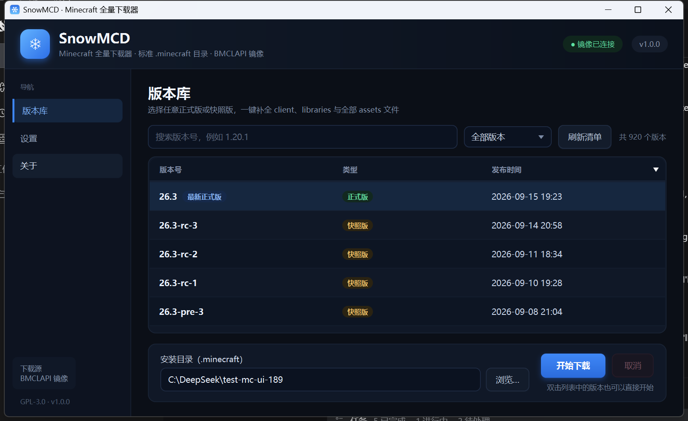
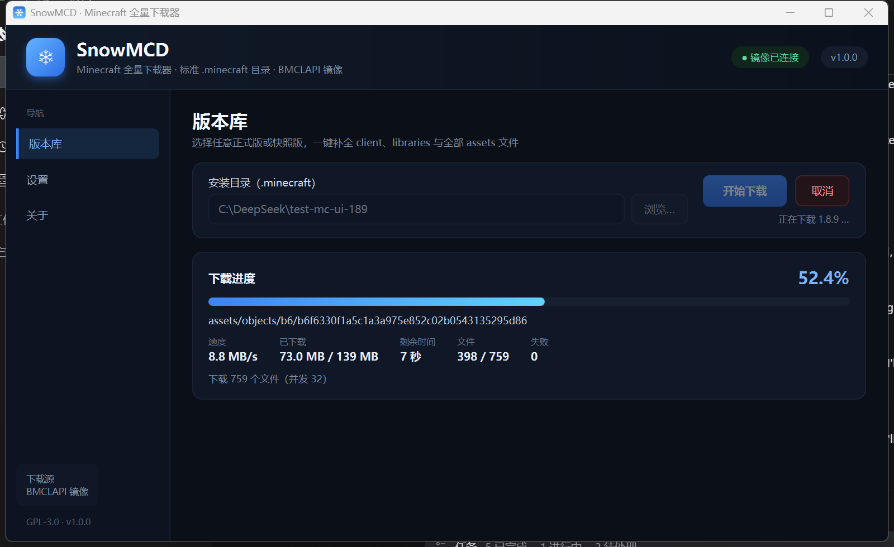
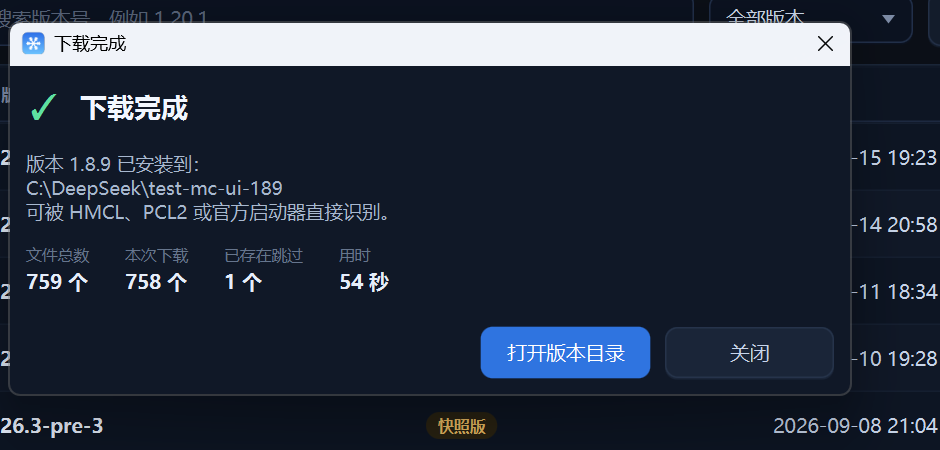

# SnowMCD

SnowMCD 是一个 JavaFX 编写的 Minecraft **全量下载器**：选择版本后，它把 `client.jar`、全部依赖库（含 LWJGL 原生库）和所有资源文件一次性补全到标准 `.minecraft` 目录，交给 HMCL / PCL2 / 官方启动器直接识别。

所有文件通过 **BMCLAPI 镜像**下载，逐文件 SHA-1 校验，支持虚拟线程并发、失败重试、取消和缓存跳过。Windows 安装包内置精简 JRE，目标机器无需安装 Java；macOS / Linux 可使用跨平台 jar。



## 功能

- **完整安装**：`versions/<id>/<id>.json`、`<id>.jar`、`libraries/**`、`assets/indexes/**`、`assets/objects/**`，以及 `versions/<id>/natives/` 原生库
- **BMCLAPI 镜像重写**：保留官方 URL 的 `/v1/...` 路径段，映射 `piston-meta` / `piston-data` → `bmclapi2.bangbang93.com`，`libraries.minecraft.net` → `/maven`，`resources.download.minecraft.net` → `/assets`；client 使用 `/version/{id}/client`
- **虚拟线程下载器**：每文件一个虚拟线程，`Semaphore` 限制并发（默认 32，可调 1–128）
- **可靠性**：单文件 3 次指数退避重试（1s / 2s / 4s）、30 秒无数据停滞检测、SHA-1 + 大小校验、`.part` 临时文件 + 原子改名
- **缓存命中**：已存在且校验通过的文件直接跳过，重复运行秒级完成
- **取消与失败重试**：可中途取消；失败文件弹窗列出，并可“仅重试失败项”
- **版本库**：启动拉取版本清单（10 分钟本地缓存），按正式版 / 快照版 / 旧版本筛选，按版本号搜索
- **深色界面**：版本表格、下载进度、速度 / 剩余时间 / 文件计数、设置与关于页
- **日志**：控制台 + `%APPDATA%\SnowMCD\logs\snowmcd.log`（4 MB 滚动，保留 5 份）

| 下载中 | 完成 |
| --- | --- |
|  |  |

## 运行环境

- Windows 10 / 11 x64：安装包 / 便携版已内置 JRE，**不需要**安装 Java
- macOS（Intel / Apple Silicon）、Linux（x64 / arm64）：使用 `SnowMCD-1.0.0-cross.jar`，需要 **JDK 25**
- 需要能访问 `https://bmclapi2.bangbang93.com`

## 安装与使用

### 安装版（推荐）

双击 `dist\SnowMCD-1.0.0.exe`，按向导安装。安装器会创建桌面与开始菜单快捷方式，可选择安装目录（默认当前用户 `%LOCALAPPDATA%\SnowMCD`）。

> 安装包未做代码签名，Windows SmartScreen 可能提示“未知发布者”；选择“更多信息 → 仍要运行”即可。

静默安装：

```bat
SnowMCD-1.0.0.exe /quiet
```

卸载：Windows“设置 → 应用”中卸载 SnowMCD，或执行安装器对应的 MSI 卸载项。

### 便携版

直接双击 `dist\SnowMCD\SnowMCD.exe`，无需安装。

### 跨平台 jar（macOS / Linux / Windows）

`dist\SnowMCD-1.0.0-cross.jar`（约 39 MB）内置 Windows x64、macOS Intel、macOS Apple Silicon、Linux x64、Linux arm64 五套 JavaFX 模块。启动时自动选择当前平台，解压到 `~/.snowmcd/libs/1.0.0/<platform>`，再以模块方式启动应用。

要求：目标机器已安装 **JDK 25**（需要 `java` 命令；JavaFX 由 jar 自带，不用另装）。

```bash
java -jar SnowMCD-1.0.0-cross.jar
```

也可以直接走命令行模式：

```bash
java -jar SnowMCD-1.0.0-cross.jar --cli --version 1.20.1 --dir ~/mc --concurrency 32
```

- macOS：Intel 与 Apple Silicon 均可。网络下载的 jar 如被 Gatekeeper 隔离，可执行
  `xattr -d com.apple.quarantine SnowMCD-1.0.0-cross.jar`，或右键选择“打开”。
- Linux：需要 GTK 3、OpenGL、fontconfig 等常见桌面依赖（如 `libgtk-3-0`、`libgl1`）。
- 低于 Java 25 的环境会直接给出明确提示，不会抛出 `UnsupportedClassVersionError`。
- 更换 jar 版本后若需强制刷新解压缓存，可删除 `~/.snowmcd/libs`。

### 使用步骤

1. 在“版本库”中选择版本（可按版本号搜索，或筛选正式版 / 快照版）
2. 选择或输入安装目录，默认 `%APPDATA%\.minecraft`
3. 点击“开始下载”，等待进度完成
4. 完成弹窗会给出安装路径，可直接打开版本目录

之后用 HMCL / PCL2 / 官方启动器把游戏目录指向该 `.minecraft` 即可。

## 目录结构

下载结果遵循官方启动器布局：

```
.minecraft/
├─ versions/
│  └─ 1.20.1/
│     ├─ 1.20.1.json      # 版本元数据（原样保留）
│     ├─ 1.20.1.jar       # client jar
│     └─ natives/         # 解压后的原生库（旧版扁平，新版保留 jar 内路径）
├─ libraries/
│  └─ org/lwjgl/...       # 依赖库 + 本机平台 natives jar
└─ assets/
   ├─ indexes/5.json      # 资源索引
   └─ objects/ab/cdef...  # 所有资源对象（按 hash 分目录）
```

## 从源码构建

环境：

- JDK 25（需要 `jmods` 与 `jpackage`；推荐 Zulu 25）
- Maven 3.9+
- WiX Toolset 3.x（只有生成 exe 安装包时需要；`candle.exe` 在 `PATH` 中）

一键构建：

```bat
build.bat
```

或：

```powershell
.\build.ps1            # 同时生成免安装目录和 exe 安装包
.\build.ps1 -SkipInstaller   # 只生成 dist\SnowMCD 便携目录
```

产物：

- `dist\SnowMCD-1.0.0.exe`：安装包（内置 JRE，约 34 MB）
- `dist\SnowMCD\SnowMCD.exe`：免安装目录（约 96 MB）
- `dist\SnowMCD-1.0.0-cross.jar`：跨平台 jar，约 39 MB

单独构建跨平台 jar：

```powershell
.\build-jar.ps1
```

它会把五个平台的 JavaFX 依赖下载到 `target\cross-libs`，与应用类一起封装进 jar；macOS / Linux 运行时不需要 Maven 或 JavaFX SDK。

开发期运行：

```bat
mvn javafx:run
```

用 IntelliJ IDEA：`File → Open` 选择本目录（Maven 工程），JDK 设为 25，运行 `com.snowmcd.Main` 即可；IDEA 会按 `pom.xml` 自动解析 JavaFX 依赖。

命令行下载模式（用于调试 / 自动化）：

```powershell
.\run-cli.ps1 --version 1.20.1 --dir D:\mc --concurrency 32
```

## 设计说明

| 模块 | 职责 |
| --- | --- |
| `model` | `VersionManifest` / `VersionInfo` / `VersionJson` / `Library` / `Rule` / `AssetIndex` / `AssetObject` 等数据模型 |
| `util.MirrorInjector` | 官方域名 → BMCLAPI 映射、client 特殊路径、asset 对象 URL |
| `util.OsInfo` / `model.Rule` | 系统识别与 Mojang `rules` 求值（os.name / os.arch / os.version / features） |
| `core.DownloadManager` | `HttpClient` + 虚拟线程 + `Semaphore` + 重试 + SHA-1 + 原子改名 + 进度回调 |
| `core.MinecraftDownloader` | 清单 → 版本 JSON → asset index → 任务编排；natives 解压；虚拟资源目录；失败重试入口 |
| `ui` | JavaFX 界面（纯代码构建，CSS 深色主题） |

版本 JSON 和 asset index 使用镜像上的官方内容；下载任务所带的 SHA-1 / 大小均来自 Mojang 元数据。`DownloadManager` 在下载前检查文件是否已存在且校验通过，因此第二次运行会全部跳过。

日志使用 `java.util.logging`（控制台 + 滚动文件），实现“控制台 + 滚动日志”的组合需求；`slf4j-simple` 本身只支持单一输出，无法同时滚动写文件。

## 已验证

在 Windows 11 + JDK 25 上实测：

| 项目 | 结果 |
| --- | --- |
| 1.20.1 全量下载 | 3641 个文件 / 701.7 MB，约 109 s（32 并发） |
| 1.20.1 重复运行 | 全部 3641 个文件校验通过并跳过，0.2 s |
| 1.8.9（旧版结构） | 759 个文件 / 139.1 MB，约 46 s；734 个资源对象、14 个原生 DLL |
| SHA-1 | 所有任务按元数据校验；重复运行时全部命中 |
| 网络抖动 | 多次 `connect timed out` / TLS 中断均由重试恢复，最终失败 0 |
| 取消 | 取消后 `cancelled=true`，无 `.part` 残留，无失败计数 |
| 原生库 | 1.20.1 解压 7 个 natives jar；1.8.9 解压 4 个（含 `${arch}` classifier） |
| 打包 | 便携版与安装包均可启动；安装 → 启动 → 静默卸载验证通过 |
| 跨平台 jar | Windows 上 `java -jar` 启动成功；macOS/arm64/linux 平台模块与原生库已校验；JDK 21 下给出友好提示 |

未在本机安装 HMCL / PCL2 进行真实游戏启动（无正版账号），但产出的目录结构与官方启动器一致。

## 已知限制 / 后续方向

- 只支持 **原版** 版本（不做 Forge / Fabric / NeoForge 安装）
- 只使用 BMCLAPI 镜像，未做多镜像负载均衡
- 不支持 HTTP Range 断点续传（中断后重下该文件，已完成的其它文件会跳过）
- 旧版（≤1.6）的 `virtual` / `map_to_resources` 资源目录已做兼容，但未纳入回归测试
- 跨平台 jar 依赖目标机器已安装 JDK 25；未在 macOS / Linux 真机上实跑（本机为 Windows），
  但对应平台的 JavaFX 模块描述符与原生库均已校验
- 后续：镜像域名切换、Mod 加载器安装、断点续传持久化

## 许可证

GPL-3.0，详见 [LICENSE](LICENSE)。

Minecraft 是 Mojang Studios 的商标；本项目仅下载官方发布的游戏文件，不包含游戏本体。镜像服务由 BMCLAPI 社区提供。
